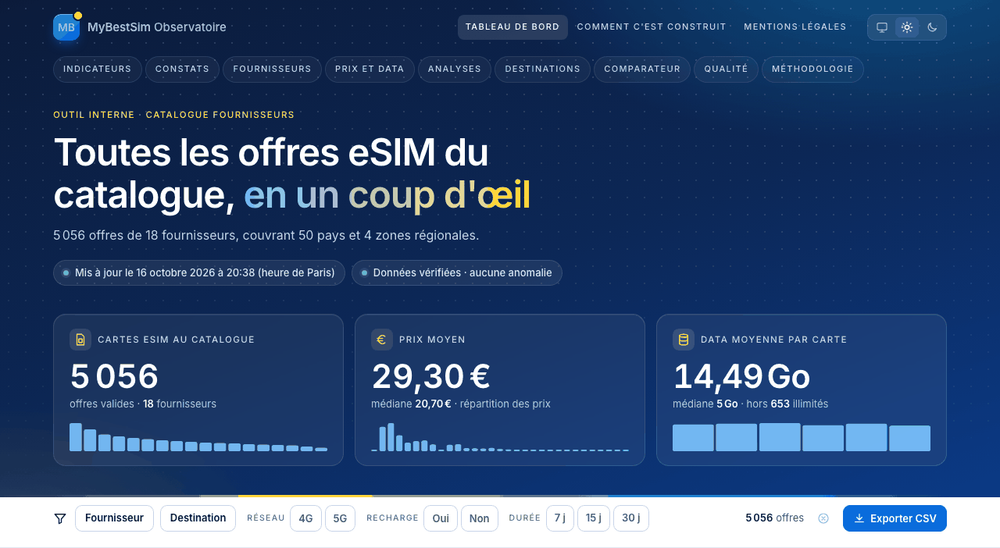
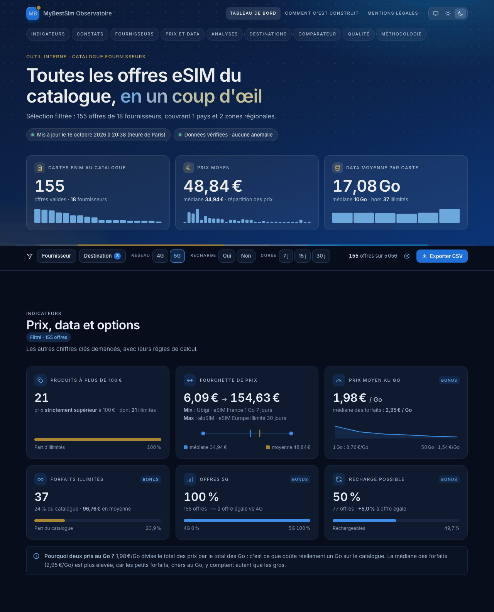
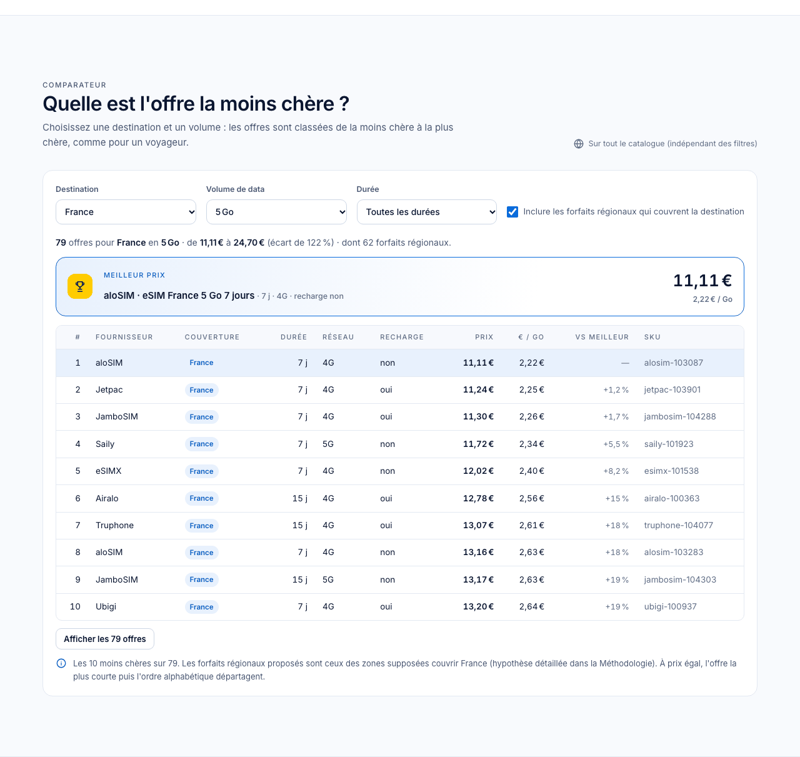

# Observatoire eSIM · MyBestSim

Tableau de bord statique du catalogue d'offres eSIM de 18 fournisseurs : volumes, prix, data,
destinations, comparateur et qualité des données. Il est régénéré automatiquement à chaque
import de données.

Réalisé par Jean Bonheur NGUEMA pour le test de recrutement **Développeur IA & Automatisation** de MyBestSim.

> Les fichiers CSV du dossier `data/` sont les **données de test fournies par MyBestSim pour le recrutement**.



| Vue filtrée (5G, France + Europe + Monde), thème sombre | Comparateur |
|---|---|
|  |  |

## Ce que fait le dashboard

- **Les 6 indicateurs demandés** :
  - nombre total de cartes eSIM ;
  - produits à plus de 100 € (strictement) ;
  - fourchette de prix, avec les produits concernés ;
  - data moyenne par carte (hors illimités, médiane en complément) ;
  - prix moyen ;
  - répartition par fournisseur (graphique et tableau triable).
- **Bonus** :
  - prix au Go (total ÷ total, médiane en complément) ;
  - répartition 4G/5G et recharge, avec l'écart **à offre égale** ;
  - durées, top des destinations, 50 pays et 4 zones séparés ;
  - fournisseurs les moins chers au Go, indice de prix à offre comparable.
- **Constats calculés** (jamais écrits en dur), par exemple « les 56 produits à plus de 100 € sont tous des forfaits illimités » ou « la 5G ne coûte que +0,9 % à offre égale ».
- **Analyses** : nuage prix/Go en échelle log avec tendance, histogramme et quantiles, heatmap fournisseur × durée, carte du prix au Go par pays.
- **Filtres en direct** (fournisseur, pays ou zone, réseau, recharge, durée), vue partageable par lien, **export CSV**.
- **Comparateur** : destination × volume × durée, forfaits régionaux inclus.
- **Qualité des données** : 20 contrôles à chaque import, rapport d'anomalies ligne par ligne.
- **Pages** : une **fiche par fournisseur** (générée automatiquement), « Comment c'est construit », mentions légales.
- Responsive (375 px), thème clair ou sombre, format français, contrastes WCAG AA vérifiés automatiquement.

## Lancer en local

Prérequis : Python 3.12 ou plus récent. Node.js et Google Chrome sont facultatifs en local (tests du moteur JS et du rendu) et obligatoires en CI.

```bash
python3 -m venv .venv
.venv/bin/pip install -r requirements.txt
.venv/bin/python -m dashboard      # data/*.csv -> docs/ (pages, stats.json, export CSV)
open docs/index.html               # s'ouvre directement, sans serveur
.venv/bin/pytest -q                # tests
```

## Ajouter un fournisseur

Déposez son fichier dans `data/` (par exemple `data/nouveau.csv`), avec l'en-tête :

```
sku,provider,product_name,country_code,country_name,data_gb,data_display,validity_days,price,currency,network,top_up
```

C'est tout : **aucune modification du code**. Le fichier est lu et contrôlé, ses offres entrent dans tous les indicateurs, et une fiche `fournisseurs/<nom>.html` est créée. Sur GitHub, le push dans `data/` déclenche la régénération et la publication. Une ligne invalide (prix manquant, devise autre que l'euro, doublon…) est exclue et signalée dans « Qualité des données », sans jamais bloquer la génération.

## Les choix faits

Ils sont tous détaillés dans la section **Méthodologie** du dashboard. En bref :

- **Illimités** : exclus de la moyenne de data (on ne fait pas la moyenne d'une quantité infinie), comptés à part, médiane affichée en plus de la moyenne.
- **Produits chers** : prix **strictement** supérieur à 100 €.
- **Prix au Go** : total des prix ÷ total des Go (coût réel d'un Go sur le catalogue), médiane des forfaits en complément.
- **Comparaisons à offre égale** (même volume, même durée), pour ne pas confondre un écart de prix avec un écart de composition du catalogue.
- **Zones** : `EU`, `AS`, `NA` (Amérique du Nord, et non la Namibie) et `WW` sont comptées à part des pays. Les pays couverts par chaque zone sont une **hypothèse** documentée (`dashboard/config.py`), utilisée seulement par le comparateur.
- **Validation** : une erreur exclut la ligne, un avertissement la garde mais la signale.
- **Python reste la source de vérité** : le moteur JS des filtres est testé contre Python (mêmes chiffres, mêmes tris).

## Vie privée et sécurité

Aucun cookie, aucun traceur, aucun tiers. La police, les librairies et le fond de carte sont hébergés dans `docs/assets/`, et leurs empreintes sont vérifiées. Toutes les pages ont une **CSP stricte** (aucun script en ligne, aucune ressource externe). Seule la préférence de thème est stockée dans le navigateur (clé `localStorage` `theme`), et seulement si le visiteur la choisit. Un test ouvre chaque page avec le réseau externe coupé et vérifie qu'aucun cookie n'est posé et qu'aucun domaine externe n'est contacté.

## Structure

```
data/                 CSV des fournisseurs (données de test)
dashboard/            code Python : lecture, validation, calculs, génération du site
  templates/          gabarit, CSS et JS du site (dont analytics.js, le moteur des filtres)
  vendor/             police et librairies hébergées localement (versions, licences, empreintes)
docs/                 site généré, publié sur GitHub Pages
tests/                tests Python, Node (moteur JS) et Chrome (rendu, accessibilité, vie privée)
```

## Licence

Code sous licence [MIT](LICENSE). Fichiers tiers sous leur propre licence (voir `dashboard/vendor/README.md`). Les données de `data/` appartiennent à MyBestSim. Outil non officiel, inspiré de l'identité visuelle de mybestsim.com.
